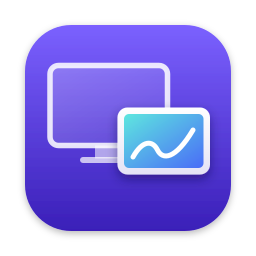

<p align="center"></p>

# Screenlet for macOS

Use an Android tablet (made for the Samsung Galaxy Tab and its S Pen) as a
second display for your Mac, over Wi-Fi or a USB-C cable, with the lowest
latency it can get. The tablet runs
[Screenlet Companion](https://github.com/DavideLoconte/Screenlet-companion);
the two speak the [Screenlet protocol](PROTOCOL.md).

Written natively in Swift with a little Objective-C and no dependencies.
Screenlet started as a fork of
[Plus One](https://github.com/GabrieleSantangelo/PlusOne).

**A proof of concept, not ready for daily use.** The version is in [VERSION](VERSION).

The other computers are [Screenlet for GNOME](https://github.com/DavideLoconte/Screenlet-linux)
and [Screenlet for Windows](https://github.com/DavideLoconte/Screenlet-windows).

## Features

- **Low latency.** About 19 ms median from capture to decoded over the
  cable, hardware H.264 or HEVC, no jitter buffer.
- **Extend or mirror.** A new display at the tablet's proportions
  (automatic, native or another size), refreshed as fast as the tablet's
  panel (up to 120 Hz, as its decoder keeps up), or one of the Mac's
  displays mirrored.
- **Touch and S Pen.** A finger moves the pointer the moment it lands,
  clicks when it lifts and drags as soon as it moves; two fingers scroll, a
  two-finger tap right-clicks; the pen sends proximity, pressure and tilt.
- **One click.** Connect pairs a new tablet by itself, then shows the desktop on it.
  An option shows it as soon as a paired tablet is plugged in. With two on the cable,
  each has its own line; one shows the desktop at a time.
- **USB cable or network.** The cable needs no developer options on the
  tablet; over Wi-Fi the tablet is found with Bonjour.
- **Simple, or as precise as you like.** The window asks for a resolution
  and what to optimize for (lowest latency, balanced, sharpest); its
  Advanced tab sets codec, refresh rate, bitrate, largest frame, packets and
  keyframes one by one, and shows the latency measured live, stage by stage.
- **Only your tablet.** Paired once by a six-digit code on both screens,
  TLS 1.3 on the link and AES-GCM on every video and input packet.

## Latency

- The hardware encoder with low-latency rate control, speed before quality,
  no reordering, BT.709 colour declared in the stream (the tablet shows the
  Mac's colours), Annex B copied once from the encoder's memory.
- Packets go out from a thread of their own, so a slow USB write never
  holds the encoder; each frame's datagrams are framed straight into one
  USB buffer.
- The Wi-Fi send queue holds about one keyframe, no more; the bitrate
  starts at half and adapts each second to the delay the tablet measures.
- No wait on a landing finger: nothing holds a touch to see if a second
  finger comes.

The log shows, every 2 s with `--show-cable`/`--show-wifi`, the median of
each stage: encoded and sent here; first packet, spread, decoder wait and
decode on the tablet ([PROTOCOL.md](PROTOCOL.md) §3.5). `measure` adds the
fidelity (luma PSNR of the Mac decoding its own stream), and `./bench.sh`
runs every codec and priority on a test pattern.

## How it works

| Part | Implementation |
|---|---|
| Second display | `CGVirtualDisplay`, a private CoreGraphics API that a macOS update could break |
| Capture and encoding | ScreenCaptureKit (NV12), VideoToolbox H.264 or HEVC with low-latency rate control |
| Bandwidth | Adjusted every second from the delay the tablet reports |
| Link and pairing | Network.framework with TLS 1.3, Bonjour discovery with `NWBrowser` |
| Video packets | AES-GCM with CryptoKit over UDP, or over the cable |
| Cable | Android Open Accessory through IOUSBHost, with no libusb |
| Touch and S Pen | CGEvents |
| App | Menu bar item and SwiftUI window, a welcome window for permissions |

H.264 and HEVC are the only encoders VideoToolbox runs in hardware, so
there are no other codecs.

## Build and install

Requires macOS 15 and Xcode 16 or later.

```bash
swift test
./build-app.sh       # dist/Screenlet.app, a zip of it and a Homebrew cask
```

To install with Homebrew, create a tap with `brew tap-new <you>/screenlet`,
copy `dist/screenlet.rb` into its `Casks` folder and run
`brew install --cask <you>/screenlet/screenlet`. The app is signed ad hoc rather
than with a Developer ID, so remove the quarantine flag with
`xattr -dr com.apple.quarantine "/Applications/Screenlet.app"`.

On first launch Screenlet asks for **Screen Recording** and **Accessibility**,
and may need to be reopened afterwards. macOS also asks for **local network**
access. The log is at `~/Library/Logs/Screenlet.log`.

**CI** tests and builds every push and pull request, and uploads the app as
the run's artifact. Pushing a `v*` tag also publishes a release with the zip
and a cask that downloads it.

## Measuring latency

```bash
"/Applications/Screenlet.app/Contents/MacOS/Screenlet" --show-cable 20 [pattern | mirror | hevc | latency | balanced | clarity | 30 | native | WxH]
```

This shows the desktop over the cable for 20 seconds and logs the latency
the tablet measures, from capture to decoded with the clocks synchronised,
every 2 seconds. `--show-wifi 20` does the same with the first paired tablet
on the network. `pattern` puts a moving test pattern (scrolling text, a
panning photo, a plasma) on the tablet's display, the same load every run, so
two runs compare.

On a Galaxy Tab S6 Lite (a slow tablet: newer ones should do better), H.264,
latency priority, with the pattern and Screenlet Companion's release build:

| | median, capture to decoded | 90th percentile |
|---|---|---|
| USB cable | 11–12 ms | 17 ms |
| Wi-Fi 5 GHz, AWDL off | 13–14 ms | 18–19 ms |

Of that, some 2–3 ms go to encoding and sending, under 1 ms to the frame's
packets reaching the decoder, and 6–7 ms to decoding.

Over Wi-Fi, AWDL (what AirDrop, Handoff, Universal Control and Sidecar use)
takes the Mac's Wi-Fi to another channel now and then, and packets wait:
on the same tablet the 90th percentile went from some 95 ms to 30–45 ms with
it off. While you use the tablet, `sudo ifconfig awdl0 down` turns it off
(AirDrop and Handoff with it) until `sudo ifconfig awdl0 up` or a restart.

## To do

- HiDPI from the tablet's density. Today it is 2x from 2560 pixels wide and 1x below,
  so a 2000 wide tablet gets none.
- HiDPI as a choice in the window, with sizes between 1x and 2x.
- Falling back to 1x if a macOS update refuses the private `hiDPI` flag of
  `CGVirtualDisplay`.
- Wi-Fi Direct: macOS has no API for it, so the tablet would host a P2P
  group the Mac joins as a Wi-Fi network (losing its own Wi-Fi meanwhile).

## License

MIT, like Plus One. See [LICENSE](LICENSE).

## AI disclosure

Much of this code was written by Claude, Anthropic's AI model, through Claude Code, under
the author's direction. The author chose what to build and tested it on real hardware.
